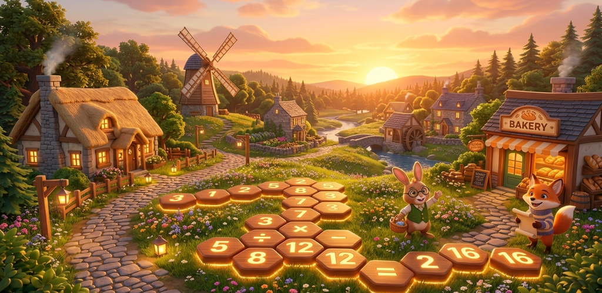

# Number Haven: Cozy Math Village 🦉🏡✨

[](https://flutter.dev)
[](https://dart.dev)
[](https://flame-engine.org)
[](https://play.google.com/store/apps/details?id=com.creatorboxstudios.numberhaven)
[](LICENSE)

> **Solve relaxing math crossword puzzles, train your brain, and build your dream woodland village!**

<p align="center">
  
</p>

---

## 📖 Overview

**Number Haven: Cozy Math Village** is a relaxing hybrid mobile puzzle game built with **Flutter** and the **Flame 2D Game Engine**. It seamlessly blends tactile **Crossmath (arithmetic crossword)** puzzle-solving with a charming, idle **woodland village-building simulation**.

Players solve equations across intersecting horizontal and vertical lines, earn stars and acorns, and use their resources to construct and upgrade woodland buildings, welcome adorable animal villagers, and unlock vibrant biomes.

* **Genre:** Crossmath / Math Crossword Puzzle × Cozy Village Simulation
* **Platforms:** Android, iOS
* **Package / Application ID:** `com.creatorboxstudios.numberhaven`
* **Google Play Store:** [Download on Google Play](https://play.google.com/store/apps/details?id=com.creatorboxstudios.numberhaven)

---

## 🌟 Key Features

### 🧩 1. Procedural Crossmath Engine
* **280 Handcrafted Campaign Levels:** Spanning four progressive difficulty tiers (Easy, Medium, Hard, and Expert).
* **Guaranteed Unique Solutions:** Algorithmic verification engine powered by **constraint-satisfaction backtracking** to mathematically guarantee exactly one valid solution per puzzle.
* **Infinite Procedural Generation:** Dynamic layout generator capable of infinitely creating fresh puzzles on demand beyond the campaign.
* **Comprehensive Arithmetic Operations:** Puzzles feature Addition (`+`), Subtraction (`−`), Multiplication (`×`), and Division (`÷`) with strict operator precedence.
* **Intelligent Hint System:**
  * **Regular Hint:** Reveals a single number cell with smooth animation.
  * **Mega Hint:** Solves an entire intersecting equation row or column.

### 🏡 2. Oakheart Village Simulation (Flame 2D Engine)
* **Cozy Isometric World:** Interactive 2D island map with pinch-to-zoom, inertial panning, and camera bounds.
* **5 Upgradable Buildings:** Construct and upgrade the Cottage, Bakery, Windmill, Library, and Tower through 3 distinct visual stages.
* **Dynamic Animations:** Real-time particle systems for chimney smoke, rotating windmill blades, and confetti celebrations.
* **Autonomous Animal Villagers:** Meet Bramble the Bunny, Fern the Fox, and Professor Hoot the Owl—each featuring waypoint pathfinding locomotion (hopping, trotting, waddling) and interactive dialogue.
* **Idle Rewards & Harvest Economy:** Buildings generate coins and hints over time with floating collection bubbles.

### 🎡 3. Daily Challenges, Streaks & Fortune Wheel
* **Calendar Daily Puzzles:** A unique daily math challenge every calendar day with milestone streak rewards (7-day, 14-day, 30-day).
* **Daily Fortune Wheel:** Spin to win bonus acorns, hints, and coins.
* **Custom Puzzle Studio:** Design custom math crossword puzzles, test-solve them, and export shareable puzzle codes for friends.
* **Village Snapshot Sharing:** Capture styled in-game postcards of your village progress and share them directly via native share sheets.

### 💰 4. Production Mobile Services & Monetization
* **Monetization (Google Mobile Ads):** Lifecycle-managed rewarded video ads, non-intrusive banner ads, and interstitials with cooldown caps.
* **In-App Purchases (IAP):** Store integration for ad removal and consumable currency bundles.
* **Game Services:** Full integration with Google Play Games & Apple Game Center for achievements and cloud leaderboards.
* **Retention Reminders:** Local notifications scheduled with timezone awareness to remind players of their daily streak.

---

## 🛠️ Architecture & Tech Stack

```text
lib/
├── app_router.dart           # App navigation & routing transitions
├── data/                     # SQLite helpers, repositories & static village definitions
│   ├── database_helper.dart
│   ├── math_level_repository.dart
│   └── village_data.dart
├── engine/                   # Math generation & algorithmic solvers
│   └── math/
│       ├── difficulty_grader.dart  # Multi-factor difficulty analysis
│       ├── evaluator.dart          # Arithmetic expression tree evaluation
│       ├── hint_engine.dart        # Strategic hint computation
│       ├── layout_generator.dart   # Crossword equation intersection generator
│       ├── logic_solver.dart       # Logical deduction solver
│       ├── puzzle_codec.dart       # Compact serialization for custom levels
│       ├── puzzle_factory.dart     # Procedural puzzle synthesizer
│       └── unique_solver.dart      # Backtracking uniqueness verifier
├── game/                     # Flame 2D game engine components
│   └── village/
│       ├── components/             # Villagers, buildings, particle emitters
│       └── village_game.dart       # Core Flame game loop & camera
├── providers/                # Reactive state management (Provider)
│   ├── game_provider.dart          # In-game board state, undo, validation
│   └── user_provider.dart          # Inventory, village progression, store, settings
├── services/                 # Native and platform integrations
│   ├── ad_service.dart             # Google Mobile Ads wrapper
│   ├── app_review_service.dart     # In-app review prompt orchestration
│   ├── game_services_helper.dart   # Play Games & Game Center leaderboards/achievements
│   ├── notification_service.dart   # Timezone-based daily notifications
│   ├── purchase_service.dart       # In-App Purchases (IAP) workflow
│   └── sound_service.dart          # Low-latency SFX and ambient audio
└── ui/                       # Modern Flutter Material 3 UI screens & dialogs
```

### Core Technologies

| Technology | Purpose |
| :--- | :--- |
| **Flutter 3.13+ & Dart 3.13+** | Cross-platform UI toolkit and application framework |
| **Flame 1.38+** | 2D game engine for village rendering, sprite animation & camera |
| **Provider** | Scoped reactive state management |
| **SQLite (`sqflite`)** | Local persistence for user progression, village state, and custom puzzles |
| **Google Mobile Ads** | AdMob banner, interstitial, and rewarded video ads |
| **In-App Purchase** | Digital store transactions & Ad-Free unlock |
| **Games Services** | Google Play Games & Apple Game Center achievements/leaderboards |
| **Flutter Local Notifications** | Scheduled local retention reminders |
| **Audioplayers & Vibration** | Dynamic audio playback and tactile haptic feedback |

---

## 🧮 Algorithmic Highlights

### Constraint Satisfaction & Uniqueness Verification
To prevent player frustration from ambiguous puzzles where multiple number assignments could satisfy the arithmetic expressions, the puzzle engine utilizes `MathUniqueSolver`:

1. **Topological Equation Mapping:** Maps each intersection cell to its participating horizontal and vertical equations.
2. **Frequency Pruning:** Optimizes tray frequency lookups to eliminate redundant permutation branches.
3. **Backtracking with Early Termination:** Searches for solutions and halts immediately once $\ge 2$ solutions are discovered, mathematically validating uniqueness in milliseconds before a level is committed.

---

## 🚀 Getting Started

### Prerequisites
* Flutter SDK `^3.13.3` or newer
* Dart SDK `^3.13.3` or newer
* Android Studio / Xcode for platform build tools

### Installation & Run

1. **Clone the repository:**
   ```bash
   git clone https://github.com/DaniruDesilva/Maths-Puzzul-Game.git
   cd Maths-Puzzul-Game
   ```

2. **Install dependencies:**
   ```bash
   flutter pub get
   ```

3. **Run on a connected device or emulator:**
   ```bash
   flutter run
   ```

### Running Tests

Execute the automated test suite covering solvers, layout generation, village state, and device compatibility:

```bash
flutter test
```

---

## 📱 Google Play Store

Experience the game on your Android device:  
🔗 **[Number Haven: Cozy Math Village on Google Play](https://play.google.com/store/apps/details?id=com.creatorboxstudios.numberhaven)**

---

## 📄 License

This project is proprietary and maintained by CreatorBox Studios. All rights reserved.
